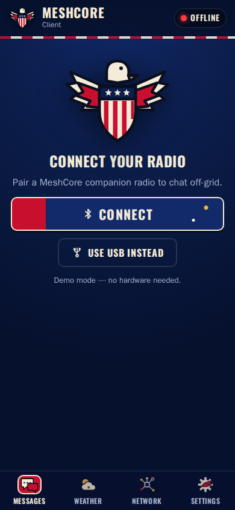
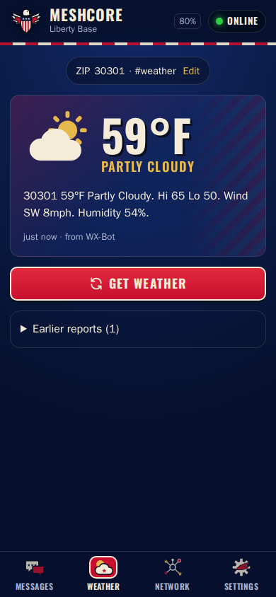
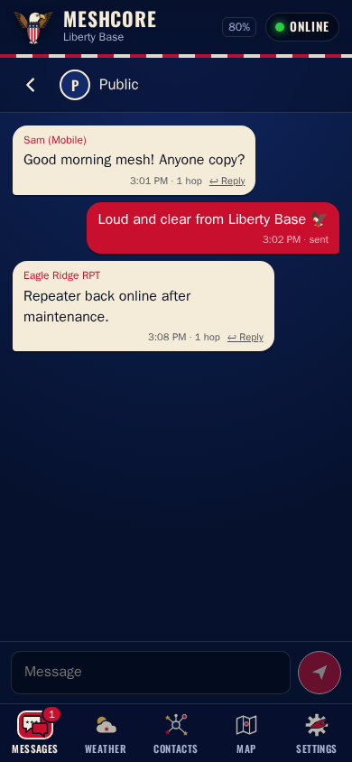
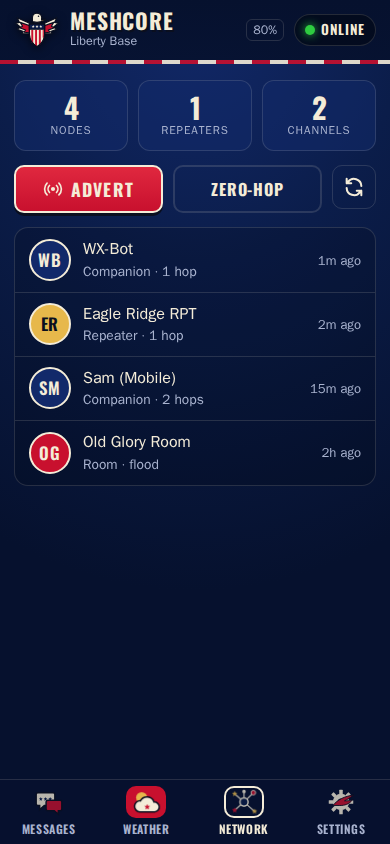
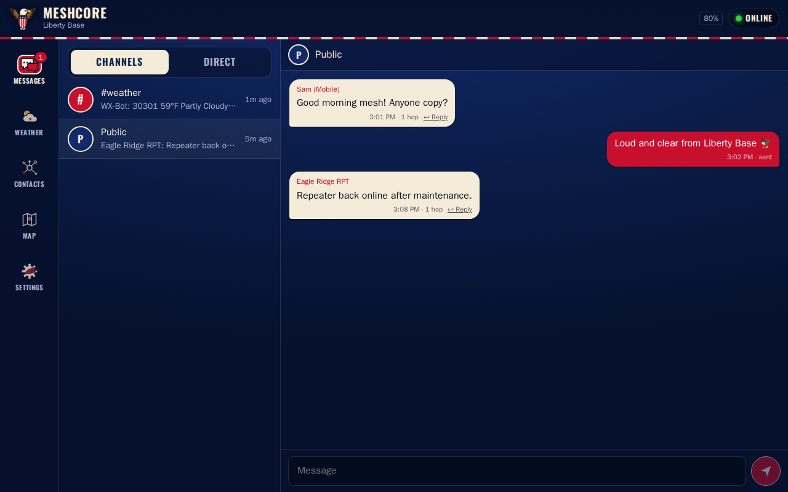

# MeshCore Client PWA

An installable, offline-capable clone of the MeshCore companion-radio web client with a
stars-and-stripes theme and a **Weather** tab. You enter your ZIP code and the hashtag
channel your weather bot uses. The app sends the ZIP to the bot over the mesh and shows
the bot's reply.

**Live:** https://kq4cin.github.io/MESHCORE_SKINZ/ · **Demo (no radio needed):** https://kq4cin.github.io/MESHCORE_SKINZ/?demo=1

| Connect | Weather | Chat | Network |
| --- | --- | --- | --- |
|  |  |  |  |



## Features
- **Connect** to a MeshCore companion radio over Bluetooth (Web Bluetooth) or USB (Web Serial).
- **Messages:** channels and direct messages, unread badges, and delivery state. History is saved on the device.
- **Weather:** a first-run setup asks for your ZIP and weather hashtag channel (default `#weather`).
  The app adds that hashtag channel to your radio for you. **Get weather** sends the bare ZIP
  (e.g. `30301`) on the channel. The newest bot reply is shown as a card, and older replies are listed under it.
  You can change the request format under **Settings → Weather → Advanced**; `{zip}` is replaced with your ZIP.
- **Network:** heard nodes (companions, repeaters, rooms), flood or zero-hop adverts, and tap-to-DM.
- **Settings:** weather settings, node name, and device info (model, firmware, battery, radio settings).
- **PWA:** install to the home screen and work offline once the app has loaded. All data stays on the device.
- **Responsive:** bottom tab bar on phones (from 320 px, safe-area aware); left rail with list and thread side by side at 900 px and up.

## Browser support
| Platform | Bluetooth | USB |
| --- | --- | --- |
| Android – Chrome / Edge | ✅ | ✅ (OTG) |
| Desktop – Chrome / Edge | ✅ | ✅ |
| iPhone / iPad | ✅ via the [Bluefy](https://apps.apple.com/app/bluefy-web-ble-browser/id1492822055) browser | ❌ |
| Firefox / Safari | ❌ | ❌ |

## How the weather channel works
MeshCore hashtag channels use a shared key. The key is the first 16 bytes of `SHA-256("#name")`.
If the channel isn't already on the radio, the app installs it in the first free channel
slot. Any message on that channel from another node is treated as a weather report.

## Development
```bash
npm install
npm run dev            # http://localhost:5173/?demo=1 for the fake radio + weather bot
npm test               # unit tests (Vitest)
npm run test:browser   # end-to-end tests at phone sizes (Playwright)
npm run build          # type-check + production build to dist/
npm run icons          # regenerate PNG icons from public/icons/*.svg
```

Planning notes, including the Elephant & Goldfish plan, are in [docs/PLAN.md](docs/PLAN.md).

Built on [`@liamcottle/meshcore.js`](https://github.com/meshcore-dev/meshcore.js) (MIT).
The theme artwork in this repo is an SVG recreation inspired by the supplied asset pack.
